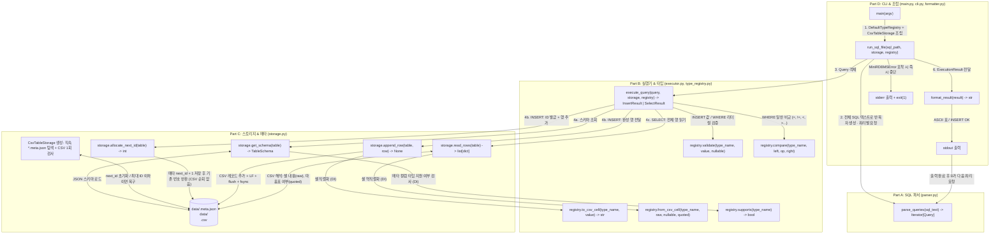

# Phase 1 탑다운 설계 및 역할 분담안

본 문서는 [`phase1-requirements.md`](./phase1-requirements.md)의 확정된 요구사항을 바탕으로 **3인 병렬 개발을 위한 탑다운 아키텍처, 역할 분담, 파일 레이아웃, 그리고 파트 간 함수 I/O 계약**을 정의합니다.

A·D의 상세 흐름, 합의된 결정 및 미결 사항은 [`phase1-ad-design.md`](./phase1-ad-design.md)에 기록합니다.
SQL 형식 문법과 예시 검토 초안은 [`phase1-sql-grammar.md`](./phase1-sql-grammar.md)를 참고합니다.

---

## 1. 전체 계층 및 함수 플로우 다이어그램



### 핵심 설계 경계
1. **엔진과 출력 분리:** 실행기(B)는 ASCII 문자열을 직접 조립하지 않고 구조화된 결과(`SelectResult`, `InsertResult`)만 반환한다. CLI 출력 포맷팅은 포맷터(D)가 전담한다.
2. **타입 핸들러 집중 (`TypeRegistry` 계약 + DI):** `INT`, `STRING`, `DATE`, `NULL`의 검증·CSV 직렬화/역직렬화·비교 연산은 `type_registry.py`(B) 한 곳에 모아 추후 타입 확장 시 파서·실행기·스토리지 수정을 최소화한다. 스토리지(C)는 `type_registry.py`를 직접 import하지 않고 공통 계약 `TypeRegistry`를 DI로 주입받는다.
3. **`next_id` 추상화:** `allocate_next_id(table_name)` 뒤에 방식을 숨긴다. 객체 생성 시 `data_dir` 직속 `*.meta.json`마다 CSV를 1회 읽고 메타의 `next_id > max(id)`를 검사한다. `next_id`가 없거나 최대 ID 이하이면 최대 ID + 1로 초기화/복구하며, 빈 테이블은 `0`부터 시작한다. 더 큰 번호는 유지한다. 이후 발급은 CSV를 순회하지 않고 메타 번호를 증가·저장한 뒤 기존 번호를 반환한다. CSV 행 저장 실패 시 증가한 메타 번호는 되돌리지 않는다.
4. **패키지 충돌 방지:**
   - 표준 라이브러리 `types` 섀도잉을 막기 위해 B의 모듈명은 `type_registry.py`로 고정한다.
   - `mini_rdbms/__init__.py`는 공통 계약 심볼만 노출하며 통합 전까지 동결한다. 각 파트는 본인 모듈 경로에서 직접 import한다.

---

## 2. 파일 레이아웃 및 3인 역할 분담

```text
main.py                             # Part D: 루트 실행 엔트리 (`python main.py <sql_file_path>`)
pyproject.toml                      # pytest pythonpath = ["."]
data/
  registrations.meta.json / .csv    # Part C: 초기 3개 테이블 스키마 및 데이터
  students.meta.json      / .csv
  courses.meta.json       / .csv
mini_rdbms/
  __init__.py                       # 공통 계약 심볼만 노출 (통합 전까지 동결)
  errors.py                         # 공통 예외 5종
  models.py                         # 공통 dataclass / 타입 별칭
  storage_interface.py              # TableStorage Protocol
  type_interface.py                 # TypeRegistry Protocol
  parser.py                         # Part A
  type_registry.py, executor.py     # Part B
  storage.py                        # Part C
  formatter.py, cli.py               # Part D
```

| 담당 | 파트 | 소유 파일 | 주요 책임 |
|---|---|---|---|
| **찬** | **A + D. SQL 파서 & CLI/포맷터** | `mini_rdbms/parser.py`, `mini_rdbms/formatter.py`, `mini_rdbms/cli.py`, `main.py` | `parse_queries`, `format_result`, `run_sql_file`, `main` |
| **담당 2** | **B. 타입 & 실행기** | `mini_rdbms/type_registry.py`, `mini_rdbms/executor.py` | `DefaultTypeRegistry`, `execute_query` |
| **담당 3** | **C. 스토리지 & 메타** | `mini_rdbms/storage.py`, `data/*` | `CsvTableStorage`, 시드 메타/CSV |

---

## 3. 공통 데이터 표현 규약

### 3.1 정규화 도메인 값 타입
`storage.read_rows`, `TypeRegistry`, `SelectResult.rows`에서 오가는 정규화 Python 값은 다음 타입을 따른다.

| `type_name` | 정규화 Python 타입 | 파서(A) 전달 형태 | 비고 |
|---|---|---|---|
| `"INT"` | `int` (`bool` 제외) | `int` | 강제 형변환(coercion) 금지 |
| `"STRING"` | `str` | `str` | `''` 이스케이프 해제된 문자열 |
| `"DATE"` | `datetime.date` | `'YYYY-MM-DD'` `str` | B(`validate`)가 엄격 형식 검증 후 `date`로 변환 |
| `NULL` | `None` | `None` | `nullable=True` 컬럼에서만 허용 |

### 3.2 `.meta.json` 및 `.csv` 파일 규약
- **`.meta.json` 구조 (`data/courses.meta.json` 예시):**
```json
{
  "table_name": "courses",
  "next_id": 0,
  "columns": [
    {"name": "id", "type_name": "INT", "nullable": false, "auto_increment": true},
    {"name": "title", "type_name": "STRING", "nullable": false, "auto_increment": false},
    {"name": "capacity", "type_name": "INT", "nullable": false, "auto_increment": false},
    {"name": "open_date", "type_name": "DATE", "nullable": true, "auto_increment": false}
  ]
}
```
  - `registrations` (`id`, `student_id`, `course_id`, `status`)와 `students` (`id`, `name`, `department`, `grade`)는 `id`만 `auto_increment: true`, 전 컬럼 `nullable: false`이다.
  - C의 `get_schema()` 및 객체 생성 검사는 `id.type_name`이 `"INT"`가 아니거나 `id.nullable=True`이면 `StorageError`로 거부한다. 다른 컬럼의 nullable 허용은 유지하며, 자동 증가 컬럼 개수·임의 이름 컬럼의 조합 검사는 추가하지 않는다.
  - 메타 구조·id 제약 검사를 끝낸 뒤 C는 모든 컬럼에 `TypeRegistry.supports(type_name)`를 호출한다. 지원 목록은 레지스트리의 타입 핸들러를 기준으로 하며 C에 중복 정의하지 않는다. `False`이면 `SchemaError`로 거부한다. 빈 테이블에서도 동일하게 검사하며, `"NULL"`은 지원 타입명이 아니다.
  - `next_id`는 bool을 제외한 0 이상의 정수다. 문자열·불리언·음수·실수·null 등 잘못된 형식은 `StorageError`이며 자동 복구하지 않는다.
  - 객체 생성은 직속 메타 파일만 대상으로 한다. CSV만 있는 파일 및 하위 디렉터리의 메타는 검사 대상이 아니다. 메타에 대응하는 CSV가 없으면 `StorageError`다.
  - 메타 갱신은 같은 디렉터리 임시 파일에 UTF-8 JSON 전체 기록 → `flush()` → `fsync()` → 파일 닫기 → `os.replace()` 순서다. 다른 메타 필드는 보존하며, 교체 전 쓰기 실패 시 원본은 유지한다. 실패하면 `StorageError`, 발급 중이면 ID를 반환하지 않는다.
  - 메타 교체와 CSV 추가는 하나의 트랜잭션이 아니다. 디렉터리 fsync를 통한 전원 장애 시 교체 내구성이나 여러 테이블 초기화의 원자성은 이번 계약에 추가하지 않는다.
- **`.csv` 구조:**
  - 첫 줄은 반드시 컬럼 헤더 행(`id,title,capacity,open_date`)을 포함한다. 빈 테이블은 헤더 1줄만 존재한다.
  - `to_csv_cell`은 문자열을 항상 큰따옴표(`"..."`, 내부 `"`는 `""`)로 감싸고, `None`만 따옴표 없이 `NULL`로 직렬화한다.
  - `storage.py`는 표준 `csv.reader`의 따옴표 소실을 막기 위해 셀의 따옴표 유무(`quoted: bool`)를 보존해 `from_csv_cell(..., quoted=...)`로 전달한다.
  - C가 CSV 바깥 큰따옴표 제거 및 내부 `""` → `"` 복원을 수행한다. `raw`는 복원된 셀 내용이고, `quoted`는 원래 셀의 따옴표 여부다. 예: `"a""b"` → `raw='a"b'`, `quoted=True`.
  - 문자열의 실제 개행은 따옴표 안에 저장하고 그대로 복원한다. 문자 두 개 `\`와 `n`을 개행으로 변환하지 않는다. CSV 레코드는 여러 물리적 줄에 걸칠 수 있다.
  - 메타 JSON과 CSV의 인코딩은 UTF-8이다. CSV는 `newline=""`로 열고 레코드마다 끝에 LF(`\n`)를 기록한다.
  - `read_rows()`는 메타 컬럼 이름·순서와 CSV 헤더를 비교한다. 셀 개수가 같은지 확인한 후 스키마의 모든 컬럼명으로 딕셔너리를 구성하므로 반환 행에는 NULL 값을 가진 컬럼을 포함해 스키마의 키가 모두 존재한다.
  - `append_row()`도 쓰기 전 기존 CSV 첫 레코드의 헤더 이름·순서·CSV 문법을 검사한다. 빈 파일·헤더 누락·불일치는 `StorageError`이며 CSV를 변경하지 않는다. 같은 파일 핸들에서 헤더 검사 후 셀 변환·파일 끝 기록을 수행하고 기존 데이터 행은 재검사하지 않는다.

---

## 4. 모듈 간 공통 데이터 계약 (구현 완료: `mini_rdbms/`)

### 4.1 파서(A) → 실행기(B): `models.py`
```python
WhereCondition = tuple[str, str, Union[int, str, None]]

@dataclass(frozen=True, slots=True)
class InsertQuery:
    table: str
    values: list[Union[int, str, None]]  # id 제외 전체 컬럼 순서대로 입력

@dataclass(frozen=True, slots=True)
class SelectQuery:
    table: str
    columns: list[str] | None            # None이면 '*' (전체 컬럼)
    where: list[WhereCondition]          # Phase 1은 AND 연결만 지원
```

### 4.2 실행기(B) ↔ 스토리지(C): `storage_interface.py`
```python
@runtime_checkable
class TableStorage(Protocol):
    def get_schema(self, table_name: str) -> TableSchema: ...
    def read_rows(self, table_name: str) -> list[dict[str, Any]]: ...
    def allocate_next_id(self, table_name: str) -> int: ...
    def append_row(self, table_name: str, row: dict[str, Any]) -> None: ...
```

### 4.3 타입 핸들러(B) ↔ 스토리지(C) / 실행기(B): `type_interface.py`
```python
@runtime_checkable
class TypeRegistry(Protocol):
    def supports(self, type_name: str) -> bool: ...
    def validate(self, type_name: str, value: Any, *, nullable: bool = False) -> Any: ...
    def compare(self, type_name: str, left: Any, op: str, right: Any) -> bool: ...
    def to_csv_cell(self, type_name: str, value: Any) -> str: ...
    def from_csv_cell(
        self, type_name: str, raw: str, *, nullable: bool = False, quoted: bool = False
    ) -> Any: ...
```

### 4.4 결과 및 공통 예외: `models.py`, `errors.py`
```python
@dataclass(frozen=True, slots=True)
class SelectResult:
    columns: list[str]
    rows: list[list[Any]]

@dataclass(frozen=True, slots=True)
class InsertResult:
    table: str
    inserted_id: int

class MiniRDBMSError(Exception): ...
class SqlSyntaxError(MiniRDBMSError): ...
class SchemaError(MiniRDBMSError): ...
class TypeMismatchError(MiniRDBMSError): ...
class StorageError(MiniRDBMSError): ...
```

---

## 5. 파트별 함수 · 클래스 I/O 명세 (각 파트 구현 계약)

### 5.1 Part A (`mini_rdbms/parser.py`)
```python
from collections.abc import Iterator

def parse_queries(sql_text: str) -> Iterator[Query]:
    """
    - 입력: SQL 파일 전체 문자열
    - 출력: 요청 시 다음 문장을 분석해 Query 하나를 전달하는 반복자
    - 뒤쪽 문장은 미리 분석하지 않으며 해당 문장 요청 시 문법 오류를 발생시킨다.
    - 빈 입력·공백·빈 문장은 건너뛰고 문자열 내부의 ';'는 구분자가 아니다.
    - SQL 요소 사이에 스페이스·탭·줄바꿈을 허용한다. 인접한 단어 사이에는 공백이 하나 이상 필요하다.
    - 이름과 키워드 사이에도 공백이 하나 이상 필요하다.
    - 큰따옴표 이름 및 작은따옴표 문자열 값 내부의 줄바꿈은 SqlSyntaxError다.
    - 정수 리터럴은 선택적인 '+' 또는 '-'와 숫자로 이루어지며 앞자리 0을 허용한다.
    - 테이블명·컬럼명은 큰따옴표로 감싼다. 이름 안의 '""'를 큰따옴표 하나로 해석한 뒤 str.strip()으로 앞뒤 공백을 제거하여 사용하며, 그 결과가 비면 거부한다. 이름 내부 ';'는 구분자가 아니다.
    - 닫히지 않은 따옴표, 비어 있지 않은 문장의 ';' 누락, 미지원 문법은 SqlSyntaxError.
    - INSERT의 VALUES ()는 빈 값 목록이므로 SqlSyntaxError. 테이블에 필요한 실제 값 개수는 B가 검증한다.
    - 주석은 지원하지 않으며 주석 문법을 별도로 인식하지 않는다.
    - 경계: 스키마/DATE 유효성/'= NULL' 의미 오류는 검사하지 않고 Part B에 위임
    """
```

`parse_queries`는 `mini_rdbms/parser.py`에 구현되어 있으며 단위 테스트는 `tests/phase1/unit/test_parser_parse_queries.py`에 둔다.
파서 내부에서 `_Reader`는 원문 위치와 어휘 읽기를 관리하고 `_Parser`는 문장·조건 구조를 분석한다. 전체 토큰 목록 없이 한 Query씩 처리한다.

### 5.2 Part B (`mini_rdbms/type_registry.py`, `mini_rdbms/executor.py`)
```python
class DefaultTypeRegistry:
    """TypeRegistry 구현체 (인자 없는 __init__)."""
    def supports(self, type_name: str) -> bool:
        # 실제 타입 핸들러 목록에 등록된 이름이면 True, 아니면 False.
    def validate(self, type_name: str, value: Any, *, nullable: bool = False) -> Any:
        # 강제 형변환 금지. DATE는 'YYYY-MM-DD' 엄격 검증 후 datetime.date 반환. 위반 시 TypeMismatchError.
    def compare(self, type_name: str, left: Any, op: str, right: Any) -> bool:
        # op in {"=", "!=", "<", "<=", ">", ">="}. 타입 불일치/미지원 op 시 TypeMismatchError.
    def to_csv_cell(self, type_name: str, value: Any) -> str:
        # None -> "NULL", str -> '"..."', int -> str(v), date -> isoformat()
    def from_csv_cell(
        self, type_name: str, raw: str, *, nullable: bool = False, quoted: bool = False
    ) -> Any:
        # not quoted and raw == "NULL" -> None (nullable=False면 StorageError)
        # STRING인데 not quoted -> StorageError

def execute_query(
    query: Query,
    storage: TableStorage,
    type_registry: TypeRegistry,
) -> ExecutionResult:
    """
    - InsertQuery: get_schema -> 값 개수(id 제외 컬럼 수) 검증(SchemaError)
                   -> validate(TypeMismatchError) -> allocate_next_id -> append_row -> InsertResult
    - SelectQuery: get_schema -> '*' 확장/컬럼 검증(SchemaError) -> read_rows -> WHERE 필터링 -> SelectResult
      - IS NULL / IS NOT NULL: row[col] is None으로 단락 처리
      - 일반 비교: 비교 리터럴이 None('= NULL')이면 TypeMismatchError, 행 값이 None이면 False(제외)
    """
```

### 5.3 Part C (`mini_rdbms/storage.py`)
```python
class CsvTableStorage:
    def __init__(self, data_dir: Path | str, type_registry: TypeRegistry) -> None:
        # 직속 *.meta.json에서 테이블명 추출, 스키마 검증 및 CSV 최초 1회 순회.
        # next_id 없음/최대 ID 이하 -> max(id)+1 저장, 빈 테이블은 0.
        # next_id가 더 크면 유지. 잘못된 next_id 형식 또는 복구 저장 실패는 StorageError.
    def get_schema(self, table_name: str) -> TableSchema:
        # 메타 JSON 없으면 SchemaError, 손상/읽기 I/O 실패 시 StorageError
        # id.type_name != "INT" 또는 id.nullable=True면 StorageError.
        # 구조/id 검사 후 supports=False인 컬럼은 SchemaError (빈 테이블 포함).
    def read_rows(self, table_name: str) -> list[dict[str, Any]]:
        # CSV 없으면 StorageError. 헤더 이름/순서, 셀 수, CSV 문법 검증.
        # C가 CSV 이스케이프 복원 후 from_csv_cell(raw, nullable=..., quoted=...) 호출.
        # 전체 행 목록 반환. 스키마의 모든 키 보장. DATE=date, NULL=None. 헤더만 있으면 [].
    def allocate_next_id(self, table_name: str) -> int:
        # 메타 next_id 읽기 -> next_id+1을 임시 파일 기록/flush/fsync/교체 -> 기존 번호 반환.
        # CSV 재순회 없음. 저장 실패 시 StorageError, ID 반환 안 함.
    def append_row(self, table_name: str, row: dict[str, Any]) -> None:
        # 키 누락/추가면 SchemaError, 파일 변경 없음. 딕셔너리 키 순서는 무관.
        # 같은 파일 핸들로 기존 헤더 이름/순서/문법 검사, 실패 시 StorageError·파일 불변.
        # 기존 데이터 행은 재검사하지 않음.
        # 스키마 순서로 row[column.name] 접근 -> to_csv_cell 호출.
        # 반환된 셀을 쉼표로 연결 + LF -> 쓰기 -> flush() -> os.fsync().
        # CSV 없으면 StorageError, 자동 생성 안 함. 파일 I/O 실패도 StorageError.
        # 발급 시 증가한 메타 next_id는 CSV 저장 실패 시에도 되돌리지 않음.
```

Part C 테스트 계약·입력·검증 시점은 [phase1-storage-tests.md](phase1-storage-tests.md)를 따른다.
타입 검증은 B 책임이며 C가 중복 수행하지 않는다. 테스트 CSV는 스키마에 맞는 값으로 준비한다.
잘못된 INT·DATE 저장값의 일반 예외 변환 정책, 원자적 롤백·부분 쓰기 복구는 이번 범위에 추가하지 않는다.

### 5.4 Part D (`mini_rdbms/formatter.py`, `mini_rdbms/cli.py`, `main.py`)
```python
def format_result(result: ExecutionResult) -> str:
    """
    - SelectResult: ASCII 박스 표('+---+') + 하단 '(N row)' 또는 '(N rows)'
      - 0건이면 헤더만 있는 빈 표 + '(0 rows)'
      - None -> 'NULL', datetime.date -> 'YYYY-MM-DD'
      - 각 열은 헤더와 변환된 값 중 가장 긴 Python 문자열 길이에 맞추고 왼쪽 정렬한다.
      - 셀 양쪽에 공백 한 칸을 둔다. 한글 등 터미널 표시 폭에 따른 보정은 하지 않는다.
    - InsertResult: 'INSERT OK (id=<n>)'
    """

def run_sql_file(
    sql_file_path: Path | str,
    storage: TableStorage,
    type_registry: TypeRegistry,
    *,
    out: TextIO = sys.stdout,
    err: TextIO = sys.stderr,
) -> int:
    """
    - SQL 파일 읽기는 CLI가 전담하며, 읽기 실패도 이 함수에서 err에 출력 후 return 1로 처리한다.
    - UTF-8로 파일 전체를 읽고 닫은 뒤 문장 처리를 시작한다.
    - 파일 없음·권한 부족·UTF-8 해석 실패 시 err에 출력하고 return 1. 파서·실행기는 호출하지 않는다.
    - parse_queries의 반복자에서 Query 1개를 받아 execute_query -> format_result 출력
    - 해당 문장의 실행·출력이 끝난 뒤에만 다음 문장을 요청한다. list(...) 등으로 미리 소비하지 않는다.
    - 반복 중 파서 오류도 포착한다. 실패 문장 이전 정상 문장의 실행·출력은 완료되어 있어야 한다.
    - MiniRDBMSError 발생 시 err에 출력 후 즉시 return 1 (후속 문장 중단, 선행 INSERT 유지)
    - 파일 읽기 및 문장 처리 오류는 예외 메시지 그대로 err에 출력한다.
    - 정상 완료 시 return 0
    """

def main(argv: list[str] | None = None) -> int:
    """
    - main.py에서 호출. DefaultTypeRegistry + CsvTableStorage(Path('data'), registry) 조립 후 run_sql_file 실행
    - 객체 생성 전에 SQL 파일 경로 인자가 정확히 하나인지 확인한다.
    - argv는 실행 파일 이름을 제외한 인자 목록이다. None이면 sys.argv[1:]을 사용한다.
    - 인자 누락·초과 시 오류와 사용법을 표준 오류에 출력하고 return 1 (객체 생성 안 함).
      문구: "SQL 파일 경로를 하나 지정해야 합니다."
            "사용법: python main.py <sql_file_path>"
    - 파일 존재·읽기 권한을 미리 검사하지 않고, 실제 읽기와 읽기 오류 처리는 run_sql_file에 맡긴다.
    - 객체 생성 과정에서 CLI 자체 책임 범위에 해당하는 오류는 이 함수에서 오류 출력 후 return 1로 처리한다.
    - run_sql_file의 반환값을 그대로 반환한다 (정상 0, 오류 1).
    - main.py는 main의 반환값을 프로그램 종료 코드로 전달한다.
    """
```

`main` 및 `main.py`의 단위 테스트는 `tests/phase1/unit/test_cli_main.py`에 둔다.
B·C 구현체와 `run_sql_file`은 main 단위 테스트에서 모의 객체로 대체한다.
`run_sql_file`은 `cli.py`에 구현되어 있으며, 별도 단위 테스트는 `tests/phase1/unit/test_cli_run_sql_file.py`에 둔다.
이 테스트는 파일 읽기·A·B·포맷터를 모의 객체로 대체해 D의 실행 순서와 중단 동작을 검증한다.
`format_result`는 `mini_rdbms/formatter.py`에 구현되어 있으며 `tests/phase1/unit/test_formatter.py`에서 독립 검증한다.
실제 SQL 파일 실행과 B·C 연결은 이 단위 테스트의 검증 범위가 아니다.
테스트별 입력·기대 결과는 A·D 문서의 [main 계약](./phase1-ad-design.md#5-main-단위-테스트-계약)과 [run_sql_file 계약](./phase1-ad-design.md#6-run_sql_file-단위-테스트-계약)을 따른다.
