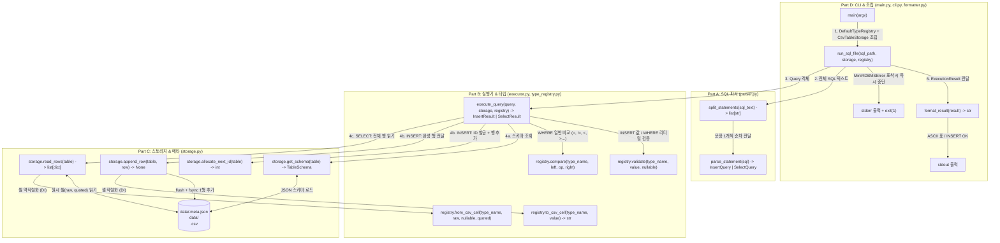

# Phase 1 탑다운 설계 및 역할 분담안

본 문서는 [`phase1-requirements.md`](./phase1-requirements.md)의 확정된 요구사항을 바탕으로 **3인 병렬 개발을 위한 탑다운 아키텍처, 역할 분담, 파일 레이아웃, 그리고 파트 간 함수 I/O 계약**을 정의합니다.

---

## 1. 전체 계층 및 함수 플로우 다이어그램



### 핵심 설계 경계
1. **엔진과 출력 분리:** 실행기(B)는 ASCII 문자열을 직접 조립하지 않고 구조화된 결과(`SelectResult`, `InsertResult`)만 반환한다. CLI 출력 포맷팅은 포맷터(D)가 전담한다.
2. **타입 핸들러 집중 (`TypeRegistry` 계약 + DI):** `INT`, `STRING`, `DATE`, `NULL`의 검증·CSV 직렬화/역직렬화·비교 연산은 `type_registry.py`(B) 한 곳에 모아 추후 타입 확장 시 파서·실행기·스토리지 수정을 최소화한다. 스토리지(C)는 `type_registry.py`를 직접 import하지 않고 공통 계약 `TypeRegistry`를 DI로 주입받는다.
3. **`next_id` 추상화:** `allocate_next_id(table_name)` 인터페이스 뒤에 영속화 방식을 숨겨, 담당자(C)가 구현 방식(CSV 스캔 복구 vs 메타 파일 기록 등)을 독립적으로 선택·교체할 수 있다.
4. **패키지 충돌 방지:**
   - 표준 라이브러리 `types` 섀도잉을 막기 위해 B의 모듈명은 `type_registry.py`로 고정한다.
   - `mini_rdbms/__init__.py`는 공통 계약 심볼만 노출하며 통합 전까지 동결한다. 각 파트는 본인 모듈 경로에서 직접 import한다.

---

## 2. 파일 레이아웃 및 3인 역할 분담

```text
main.py                             # Part D: 루트 실행 엔트리 (`python main.py <sql_file_path>`)
pyproject.toml                      # pytest pythonpath = ["."]
data/
  registrations.meta.json / .csv    # Part C: 초기 3개 테이블 스키마 및 데이터
  students.meta.json      / .csv
  courses.meta.json       / .csv
mini_rdbms/
  __init__.py                       # 공통 계약 심볼만 노출 (통합 전까지 동결)
  errors.py                         # 공통 예외 5종
  models.py                         # 공통 dataclass / 타입 별칭
  storage_interface.py              # TableStorage Protocol
  type_interface.py                 # TypeRegistry Protocol
  parser.py                         # Part A
  type_registry.py, executor.py     # Part B
  storage.py, formatter.py, cli.py  # Part C + D
```

| 담당 | 파트 | 소유 파일 | 주요 책임 |
|---|---|---|---|
| **담당 1** | **A. SQL 파서** | `mini_rdbms/parser.py` | `split_statements`, `parse_statement` |
| **담당 2** | **B. 타입 & 실행기** | `mini_rdbms/type_registry.py`, `mini_rdbms/executor.py` | `DefaultTypeRegistry`, `execute_query` |
| **담당 3** | **C + D. 스토리지 & CLI/포맷터** | `mini_rdbms/storage.py`, `mini_rdbms/formatter.py`, `mini_rdbms/cli.py`, `main.py`, `data/*` | `CsvTableStorage`, `format_result`, `run_sql_file`, `main`, 시드 메타/CSV |

---

## 3. 공통 데이터 표현 규약

### 3.1 정규화 도메인 값 타입
`storage.read_rows`, `TypeRegistry`, `SelectResult.rows`에서 오가는 정규화 Python 값은 다음 타입을 따른다.

| `type_name` | 정규화 Python 타입 | 파서(A) 전달 형태 | 비고 |
|---|---|---|---|
| `"INT"` | `int` (`bool` 제외) | `int` | 강제 형변환(coercion) 금지 |
| `"STRING"` | `str` | `str` | `''` 이스케이프 해제된 문자열 |
| `"DATE"` | `datetime.date` | `'YYYY-MM-DD'` `str` | B(`validate`)가 엄격 형식 검증 후 `date`로 변환 |
| `NULL` | `None` | `None` | `nullable=True` 컬럼에서만 허용 |

### 3.2 `.meta.json` 및 `.csv` 파일 규약
- **`.meta.json` 구조 (`data/courses.meta.json` 예시):**
```json
{
  "table_name": "courses",
  "columns": [
    {"name": "id", "type_name": "INT", "nullable": false, "auto_increment": true},
    {"name": "title", "type_name": "STRING", "nullable": false, "auto_increment": false},
    {"name": "capacity", "type_name": "INT", "nullable": false, "auto_increment": false},
    {"name": "open_date", "type_name": "DATE", "nullable": true, "auto_increment": false}
  ]
}
```
  - `registrations` (`id`, `student_id`, `course_id`, `status`)와 `students` (`id`, `name`, `department`, `grade`)는 `id`만 `auto_increment: true`, 전 컬럼 `nullable: false`이다.
- **`.csv` 구조:**
  - 첫 줄은 반드시 컬럼 헤더 행(`id,title,capacity,open_date`)을 포함한다. 빈 테이블은 헤더 1줄만 존재한다.
  - `to_csv_cell`은 문자열을 항상 큰따옴표(`"..."`, 내부 `"`는 `""`)로 감싸고, `None`만 따옴표 없이 `NULL`로 직렬화한다.
  - `storage.py`는 표준 `csv.reader`의 따옴표 소실을 막기 위해 셀의 따옴표 유무(`quoted: bool`)를 보존해 `from_csv_cell(..., quoted=...)`로 전달한다.

---

## 4. 모듈 간 공통 데이터 계약 (구현 완료: `mini_rdbms/`)

### 4.1 파서(A) → 실행기(B): `models.py`
```python
WhereCondition = tuple[str, str, Union[int, str, None]]

@dataclass(frozen=True, slots=True)
class InsertQuery:
    table: str
    values: list[Union[int, str, None]]  # id 제외 전체 컬럼 순서대로 입력

@dataclass(frozen=True, slots=True)
class SelectQuery:
    table: str
    columns: list[str] | None            # None이면 '*' (전체 컬럼)
    where: list[WhereCondition]          # Phase 1은 AND 연결만 지원
```

### 4.2 실행기(B) ↔ 스토리지(C): `storage_interface.py`
```python
@runtime_checkable
class TableStorage(Protocol):
    def get_schema(self, table_name: str) -> TableSchema: ...
    def read_rows(self, table_name: str) -> list[dict[str, Any]]: ...
    def allocate_next_id(self, table_name: str) -> int: ...
    def append_row(self, table_name: str, row: dict[str, Any]) -> None: ...
```

### 4.3 타입 핸들러(B) ↔ 스토리지(C) / 실행기(B): `type_interface.py`
```python
@runtime_checkable
class TypeRegistry(Protocol):
    def validate(self, type_name: str, value: Any, *, nullable: bool = False) -> Any: ...
    def compare(self, type_name: str, left: Any, op: str, right: Any) -> bool: ...
    def to_csv_cell(self, type_name: str, value: Any) -> str: ...
    def from_csv_cell(
        self, type_name: str, raw: str, *, nullable: bool = False, quoted: bool = False
    ) -> Any: ...
```

### 4.4 결과 및 공통 예외: `models.py`, `errors.py`
```python
@dataclass(frozen=True, slots=True)
class SelectResult:
    columns: list[str]
    rows: list[list[Any]]

@dataclass(frozen=True, slots=True)
class InsertResult:
    table: str
    inserted_id: int

class MiniRDBMSError(Exception): ...
class SqlSyntaxError(MiniRDBMSError): ...
class SchemaError(MiniRDBMSError): ...
class TypeMismatchError(MiniRDBMSError): ...
class StorageError(MiniRDBMSError): ...
```

---

## 5. 파트별 함수 · 클래스 I/O 명세 (각 파트 구현 계약)

### 5.1 Part A (`mini_rdbms/parser.py`)
```python
def split_statements(sql_text: str) -> list[str]:
    """
    - 입력: SQL 파일 전체 문자열
    - 출력: ';' 기준으로 분리된 개별 SQL 문장 리스트 (문자열 '...' 안의 ';'는 무시)
    - 예외(SqlSyntaxError): 닫히지 않은 따옴표, ';' 누락, 빈 문장('; ;'), 주석('--', '/* */')
    """

def parse_statement(sql: str) -> Query:
    """
    - 입력: 단일 SQL 문장 1개
    - 출력: InsertQuery | SelectQuery (SELECT * 이면 columns=None)
    - 예외(SqlSyntaxError): 미지원 문법(컬럼 지정 INSERT, UPDATE, OR, JOIN 등)
    - 경계: 스키마/DATE 유효성/'= NULL' 의미 오류는 검사하지 않고 Part B에 위임
    """
```

### 5.2 Part B (`mini_rdbms/type_registry.py`, `mini_rdbms/executor.py`)
```python
class DefaultTypeRegistry:
    """TypeRegistry 구현체 (인자 없는 __init__)."""
    def validate(self, type_name: str, value: Any, *, nullable: bool = False) -> Any:
        # 강제 형변환 금지. DATE는 'YYYY-MM-DD' 엄격 검증 후 datetime.date 반환. 위반 시 TypeMismatchError.
    def compare(self, type_name: str, left: Any, op: str, right: Any) -> bool:
        # op in {"=", "!=", "<", "<=", ">", ">="}. 타입 불일치/미지원 op 시 TypeMismatchError.
    def to_csv_cell(self, type_name: str, value: Any) -> str:
        # None -> "NULL", str -> '"..."', int -> str(v), date -> isoformat()
    def from_csv_cell(
        self, type_name: str, raw: str, *, nullable: bool = False, quoted: bool = False
    ) -> Any:
        # not quoted and raw == "NULL" -> None (nullable=False면 StorageError)
        # STRING인데 not quoted -> StorageError

def execute_query(
    query: Query,
    storage: TableStorage,
    type_registry: TypeRegistry,
) -> ExecutionResult:
    """
    - InsertQuery: get_schema -> 값 개수(id 제외 컬럼 수) 검증(SchemaError)
                   -> validate(TypeMismatchError) -> allocate_next_id -> append_row -> InsertResult
    - SelectQuery: get_schema -> '*' 확장/컬럼 검증(SchemaError) -> read_rows -> WHERE 필터링 -> SelectResult
      - IS NULL / IS NOT NULL: row[col] is None으로 단락 처리
      - 일반 비교: 비교 리터럴이 None('= NULL')이면 TypeMismatchError, 행 값이 None이면 False(제외)
    """
```

### 5.3 Part C (`mini_rdbms/storage.py`)
```python
class CsvTableStorage:
    def __init__(self, data_dir: Path | str, type_registry: TypeRegistry) -> None: ...
    def get_schema(self, table_name: str) -> TableSchema:
        # 테이블 없으면 SchemaError, .meta.json 손상 시 StorageError
    def read_rows(self, table_name: str) -> list[dict[str, Any]]:
        # 헤더/컬럼 수 불일치, 파싱 오류 시 StorageError
    def allocate_next_id(self, table_name: str) -> int:
        # 재실행 후에도 기존 최대 id + 1 연속성 보장 (구현 방식 자율)
    def append_row(self, table_name: str, row: dict[str, Any]) -> None:
        # 스키마 키 일치 확인 -> to_csv_cell 직렬화 -> 1줄 쓰기 + flush() + os.fsync()
```

### 5.4 Part D (`mini_rdbms/formatter.py`, `mini_rdbms/cli.py`, `main.py`)
```python
def format_result(result: ExecutionResult) -> str:
    """
    - SelectResult: ASCII 박스 표('+---+') + 하단 '(N row)' 또는 '(N rows)'
      - 0건이면 헤더만 있는 빈 표 + '(0 rows)'
      - None -> 'NULL', datetime.date -> 'YYYY-MM-DD'
    - InsertResult: 'INSERT OK (id=<n>)'
    """

def run_sql_file(
    sql_file_path: Path | str,
    storage: TableStorage,
    type_registry: TypeRegistry,
    *,
    out: TextIO = sys.stdout,
    err: TextIO = sys.stderr,
) -> int:
    """
    - split_statements 후 문장 1개씩 parse_statement -> execute_query -> format_result 출력
    - MiniRDBMSError 발생 시 err에 출력 후 즉시 return 1 (후속 문장 중단, 선행 INSERT 유지)
    """

def main(argv: list[str] | None = None) -> int:
    """
    - main.py에서 호출. DefaultTypeRegistry + CsvTableStorage(Path('data'), registry) 조립 후 run_sql_file 실행
    """
```
