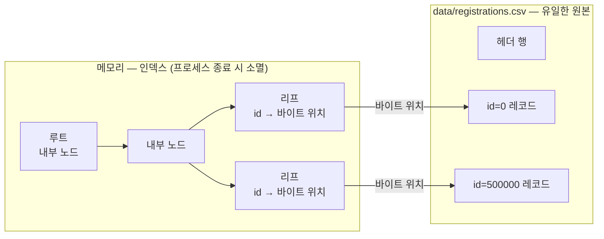

# Phase 2 B+ 트리 인덱스 설계

본 문서는 Phase 2의 **설계 결정**과 그 근거를 기록한다. 요구사항은 [`phase2-requirements.md`](./phase2-requirements.md)에서 확인하며, 이 문서는 요구사항 문서를 대체하지 않는다.

- **확정**: 사용자와 합의한 설계. 이 문서에 기록된 내용만 확정으로 본다.
- **미확정**: 요구사항 §9에서 설계 단계로 넘긴 항목. 아직 합의되지 않았으며, 결정 전까지 구현 근거로 사용하지 않는다.

참조 문서:

- [`phase2-requirements.md`](./phase2-requirements.md) — Phase 2 확정 요구사항
- [`phase1-requirements.md`](./phase1-requirements.md) — 유지되는 Phase 1 계약
- [`phase1-design.md`](./phase1-design.md) — 저장소·실행기 구조
- [`phase1-storage-tests.md`](./phase1-storage-tests.md) — 저장소 테스트 계약

---

## 1. 결정 상태

| # | 요구사항 §9 항목 | 상태 | 결정 |
|---|---|---|---|
| 1 | 노드 구조와 최대 키 수(차수) | 확정 | D-01~09 (분할 규칙 D-08~09 포함) |
| 2 | 테스트에서 노드 분할을 강제하는 작은 차수 설정 방법 | 확정 | D-06~07 |
| 3 | 리프 노드 연결 방식과 범위 조회 알고리즘 | 확정 | D-14 (§5.2) |
| 4 | 저장소 인터페이스의 바이트 위치 조회·범위 조회 메서드 | 확정 | D-18 (§4.3) |
| 5 | 실행기에서 인덱스 경로를 선택하는 조건 판정 위치 | 확정 | D-10 (§4.1) |
| 6 | 조회 통계를 전달하는 인터페이스 형태 | 확정 | D-19 (§4.4) |
| 7 | 인덱스 구축과 `next_id` 보정을 한 번의 스캔으로 합치는 방법 | 확정 | D-15 (§6) |
| 8 | 벤치마크 스크립트의 CLI 옵션과 결과 출력 형식 | 확정 (관례) | D-17 (§7) |
| 9 | 파일별 테스트 ID와 세부 기대값 | 확정 | D-20 (§8) |

---

## 2. 인덱스 모델 (요구사항 요약)

요구사항 §3의 확정 내용을 설계 참조용으로 요약한다. 이 절은 요구사항을 변경하지 않는다.

| 항목 | 확정 내용 | 출처 |
|---|---|---|
| 키 | 자동 증가 `id` (`INT`, 중복 없음) | 요구사항 §3.1 |
| 값 | 레코드가 시작하는 CSV 파일의 바이트 위치 | 요구사항 §3.1 |
| 노드 위치 | 메모리 | 요구사항 §3.1 |
| 원본 데이터 | CSV 파일 (파일이 유일한 원본) | 요구사항 §3.1 |
| 인덱스 수명 | 프로세스 실행 중에만 유지 | 요구사항 §3.1 |
| 구축 시점 | `CsvTableStorage` 생성 시 모든 테이블 | 요구사항 §3.2 |
| 삽입 | CSV 추가 성공 후 인덱스 등록 | 요구사항 §3.3 |

메모리 인덱스와 파일 원본의 관계:



---

## 3. 노드 표현 (확정)

### 3.1 노드 종류 분리

**D-01. 내부 노드와 리프 노드를 서로 다른 클래스로 표현한다.**

| 노드 | 보관 내용 |
|---|---|
| `InternalNode` | 검색 기준 키 목록, 자식 노드 목록 |
| `LeafNode` | `(id, 바이트 위치)` 엔트리 목록 |

근거:

- 노드 종류를 클래스로 구분하면 역할이 코드 구조에 드러나 삽입·분할·검색 알고리즘을 읽을 때 노드별 책임이 분명해진다.
- 노드마다 사용하지 않는 필드가 생기지 않는다.
- 잘못된 필드 조합(예: 리프에 자식 목록)을 표현 자체로 막을 수 있다.

대안으로 검토한 "하나의 노드 구조에 종류 표시를 두는 방식"은 공통 구조가 하나라는 장점이 있으나, 노드마다 사용하지 않는 필드가 남고 `kind` 값과 실제 사용 필드가 어긋날 수 있어 채택하지 않았다.

### 3.2 자식 타입

**D-02. `Node = InternalNode | LeafNode` 타입 별칭으로 자식 노드 타입을 표현한다.**

내부 노드의 자식은 내부 노드일 수도, 리프일 수도 있다. 이 재귀 관계를 하나의 이름으로 표현하기 위해 별칭을 둔다.

파이썬의 `Union`은 **정적 타입 표기**이며 런타임 태그를 만들지 않는다. 객체는 항상 `InternalNode` 인스턴스이거나 `LeafNode` 인스턴스이고, `Node` 라는 객체는 존재하지 않는다. 따라서 `Union` 표기와 런타임 판별은 별개의 문제이며, 판별 규칙은 D-03에서 정한다.

### 3.3 런타임 판별

**D-03. 노드 종류 판별은 `isinstance`를 사용한다.**

근거:

- 클래스 자체가 종류를 나타내므로 별도 판별 필드가 필요 없다.
- 판별 신호가 하나뿐이라 "태그 값과 실제 클래스가 다르다"는 불일치가 생길 수 없다.
- 파이썬에서 관용적인 방식이며, 구조적 패턴 매칭(`case LeafNode():`)도 같은 규칙으로 동작한다.

`kind` 태그 필드는 인덱스 파일 영속화에서 의미가 생기지만, 요구사항 §2.2가 인덱스 파일 영속화를 제외하므로 이번 범위에서는 두지 않는다.

### 3.4 차수와 노드 내부 탐색 (확정)

**D-04. 노드 내부 키 탐색은 이진 탐색을 사용한다.**

내부 노드의 키 목록과 리프의 `id` 엔트리 목록은 항상 정렬되어 있으므로 이진 탐색이 성립한다. 파이썬 표준 라이브러리 `bisect`를 사용해 비교를 C 수준에서 수행하고, 노드당 비교 횟수를 `O(log k)`로 둔다.

내부 노드에서 자식을 고르는 방향(`bisect_left` / `bisect_right`)은 **분할 규칙에 의존**한다. "키가 오른쪽 자식의 첫 키인가, 왼쪽 자식의 최대 키인가"가 정해져야 방향이 결정되므로, 실제 호출 방향은 분할 규칙 확정 시 함께 고정한다.

**D-05. 노드당 최대 키 수의 기본값은 128이다.**

| 최대 키 | 자식 수 | 100만 건 시 깊이(근사) | 노드 총 개수(근사) |
|---:|---:|---:|---:|
| 3 | 4 | 10 | 약 33만 |
| 64 | 65 | 4 | 약 15,900 |
| 128 | 129 | 3 | 약 7,900 |

이진 탐색을 전제로 하면 **전체 비교 횟수는 차수와 거의 무관**하다. 노드 하나의 비용은 `log₂(k)`, 깊이는 `log(k+1)(N)`이므로 곱이 대략 `log₂(N)`으로 일정하다. 따라서 차수 선택에서 남는 차이는 비교 횟수가 아니라 **노드 방문 횟수**와 **노드 덤프 가독성**이다.

128을 택한 근거:

- 깊이 3으로 64의 4보다 노드 방문이 1단계 적다. 요구사항 §6.4가 방문 노드 수를 보고 지표로 요구한다.
- 100만 건에서 노드 객체 수가 절반 수준이다.
- 분할 1회 복사량은 늘지만 상각 비용은 차수와 무관하다.

디스크 페이지 제약이 없으므로 차수를 저장 효율로 정할 이유는 없다. 삭제가 범위에서 제외되어(요구사항 §2.2) 최소 점유율 규칙도 두지 않는다.

메모리 추정: 100만 엔트리를 파이썬 객체로 담으면 대략 100~130MB로 추정된다. 이는 설계 확정값이 아니라 벤치마크에서 실측해 보고할 항목이다.

테스트 리스크: 테스트는 작은 차수로 분할을 강제하므로, 기본 차수 128의 분할 경로는 작은 차수 테스트에서 다뤄지지 않는다. 완화책(기본 차수에서 깊은 트리를 한 번 만드는 스모크 테스트)은 §8.1의 T-19로 고정한다.

### 3.5 설정 검증과 테스트 주입 (확정)

용어를 다음과 같이 고정한다. 문헌의 `order`는 "최대 자식 수"와 "최대 키 수" 양쪽으로 쓰여 모호하므로 이 문서에서 사용하지 않는다.

| 용어 | 의미 |
|---|---|
| `max_keys` | 노드 하나가 담을 수 있는 키 개수의 **상한** (D-05: 기본 128) |
| 허용 설정 하한 | `max_keys` 인자로 받아들일 수 있는 **최소값** (D-06: 3) |
| 최소 점유율 | 노드가 채워야 하는 하한. 삭제가 범위 밖이므로(요구사항 §2.2) 두지 않는다 |

**D-06. `max_keys`의 허용 설정 하한은 3이다.**

- 3 미만은 생성 시 거부한다. 거부 시 예외는 D-13에 따라 `ValueError`다.
- 근거: `max_keys = 1`이면 내부 노드 분할이 성립하지 않는다. 키 2개를 두 노드로 나누면 한쪽이 키 0개가 되어 내부 노드가 될 수 없다. `max_keys = 2`는 동작하지만 지원할 이득이 없고, 테스트에서 쓸 값(3)보다 작아 실제 이점이 없다.
- 이 하한은 트리 이론의 불변식이 아니라, 설정 인자를 어디까지 받아줄지 정하는 검증 규칙이다.

**D-07. 테스트용 차수 주입은 `CsvTableStorage` 생성자의 키워드 인자 `index_max_keys`로 한다.**

- 시그니처: `CsvTableStorage(data_dir, type_registry, *, index_max_keys: int = 128)`
- 저장소는 이 값을 각 테이블의 `BPlusTree` 생성에 그대로 전달한다. 인덱스 생성 책임은 저장소에 남는다.
- Phase 1의 `TypeRegistry`처럼 인터페이스를 주입하는 방식과 달리, 바꿀 값이 정수 하나이므로 팩토리 계층을 두지 않는다.
- 단위 테스트는 `BPlusTree(max_keys=3)`을 직접 만들고, 저장소 통합 테스트는 `index_max_keys=3`으로 분할을 강제한다.

### 3.6 분할 규칙 (관례 채택)

**D-08. 부모 키는 오른쪽 자식의 첫 키로 둔다(규약 A).**

- 불변식: 왼쪽 자식의 모든 키 `<` 부모 키 `≤` 오른쪽 자식의 모든 키
- 내부 노드에서 자식을 고를 때 `bisect_right`를 사용한다.
- 리프 분할: 승격 키를 오른쪽 리프에 **남기고 부모로 복사**한다. 따라서 부모 키와 리프 엔트리가 중복될 수 있다.
- 내부 분할: 승격 키를 부모로 **이동**하고 자식 쪽에서 제거한다.

**D-09. 분할 지점은 `p = (max_keys + 1) // 2`로 통일한다.**

- 리프: `entries[p]`가 오른쪽 리프의 첫 엔트리이자 승격 키
- 내부: `keys[p]`가 부모로 이동하는 키
- 예: `max_keys = 3`이면 넘친 4개에서 `p = 2`, 왼쪽 2개·오른쪽 2개

D-08과 D-09는 B+ 트리 문헌의 표준 규약이며 프로젝트 고유의 트레이드오프가 없다. 사용자 요청에 따라 개별 확인 질문 대신 관례로 채택하고, 이견이 있으면 변경한다.

### 3.7 노드 필드와 설정 검증 (확정)

**D-12. 노드 필드는 가변으로 둔다.**

- 노드 필드는 삽입과 분할 중에 바뀌므로 `frozen=True`를 쓰지 않는다. `@dataclass(slots=True)`만 사용한다.
- 리프의 `next`는 `LeafNode | None`이며 분할 시 갱신한다(D-14).
- 분할할 때 리스트를 잘라 새 리스트로 교체한다(`node.entries = node.entries[:p]`). 자식이 들고 있던 참조가 남지 않게 하기 위해서다.

**D-13. `max_keys` 검증 실패는 `ValueError`로 거부한다.**

- `type(max_keys) is not int` 또는 `max_keys < 3`이면 생성자에서 `ValueError`를 낸다. `bool`은 `int`의 하위 타입이므로 `type(...) is not int`로 명시적으로 제외한다.
- `StorageError`를 쓰지 않는 이유: 데이터 문제가 아니라 호출자의 설정 오류이고, `CsvTableStorage`의 파일 오류와 구분되어야 한다.

---

## 4. 조회 경로와 저장소 계약

### 4.1 판정 주체 (확정)

**D-10. 인덱스 경로 사용 여부는 실행기가 판정한다.**

- 실행기는 이미 `WHERE` 조건을 해석하고(`_prepare_where`) 비교·`IS NULL`·`AND`를 판정한다.
- 저장소는 "id로 후보 레코드를 읽는" 저수준 기능만 제공하고 SQL 의미를 모른다.
- Phase 3 API 서버도 같은 실행기를 재사용하므로, SQL 의미 판정이 실행기에 남는 편이 유리하다.

역할을 다음과 같이 구분한다. "인덱스 사용"이라는 표현은 소유·수행·판정을 섞으므로 이 문서에서 역할 이름으로 쓰지 않는다.

| 역할 | 주체 | 내용 |
|---|---|---|
| 소유 | `CsvTableStorage` | 테이블별 `BPlusTree` 인스턴스를 보관 |
| 수행 | `CsvTableStorage` → `BPlusTree` | 실제 노드 탐색과 오프셋 반환 |
| 판정 | `execute_query` | `WHERE`를 보고 인덱스 조회를 요청할지 전체 읽기를 요청할지 결정 |

실행기는 `BPlusTree`를 직접 참조하지 않는다. 실행기가 아는 것은 `id` 구간 값과 저장소 메서드 이름뿐이다.

요구사항 §3.4의 접근 경로 표를 실행기에서 구현한다.

| `WHERE` 조건 | 접근 경로 |
|---|---|
| `id = 값` | 인덱스 등호 조회 |
| `id` 비교·범위 | 인덱스 범위 조회 |
| 여러 `id` 조건의 `AND` | 구간 교집합 |
| `id` 조건 + 다른 필드 조건 | 인덱스 후보 조회 후 나머지 조건 필터 |
| `id != 값`, `id IS NULL`, `id IS NOT NULL`, `id` 조건 없음 | 전체 읽기 |

### 4.2 방문 노드 수 (확정)

**D-11. `node_visits`는 조회 1회에서 실제로 참조한 노드 수다.**

- 조회마다 0에서 시작한다. 누적하지 않는다.
- 노드의 키 목록이나 엔트리 목록을 참조한 순간 1 증가한다. 같은 노드를 여러 번 참조해도 1회로 센다.
- 리프 사이를 `next`로 이동하는 것도 방문으로 센다.
- 없는 키도 리프까지 내려가므로 깊이만큼 센다.

| 상황 | `node_visits` | `rows` |
|---|---:|---:|
| 빈 트리(루트 리프)에서 조회 | 1 | 0 |
| 깊이 3에서 등호 조회 (존재·미존재 모두) | 3 | 1 또는 0 |
| 깊이 3에서 리프 2개에 걸친 범위 | 4 | 해당 건수 |
| 전체 읽기 경로 | 0 | 전체 |

이 값은 벤치마크 보고 항목(요구사항 §6.4)이자 테스트 기대값이다.

### 4.3 저장소 조회 메서드 (확정)

**D-18. 저장소는 `find_by_id`와 `find_by_id_range` 두 메서드로 id 기반 조회를 제공한다.**

```python
@dataclass(frozen=True, slots=True)
class IndexLookupResult:
    rows: list[dict[str, Any]]
    node_visits: int

def find_by_id(self, table_name: str, record_id: int) -> IndexLookupResult: ...
def find_by_id_range(
    self, table_name: str, lower: int | None, upper: int | None
) -> IndexLookupResult: ...
```

- 범위는 반개구간 `[lower, upper)`, `None`은 무한이다.
- 바이트 오프셋은 저장소 밖으로 나오지 않는다. 노출하면 실행기가 CSV 셀을 파싱해야 하고 Phase 1의 디코딩 경계가 깨진다.
- 등호를 `find_by_id`로 따로 두는 이유는 통계 라벨(`index` / `range`)을 구분하기 위해서다.
- 부등호 정규화는 실행기가 한다. `id > 5` → `lower=6`, `id <= 9` → `upper=10`. 정수 도메인이라 ±1이 성립하고 파이썬 정수는 넘치지 않는다.

### 4.4 조회 통계 (확정)

**D-19. 조회 통계는 `execute_query`의 키워드 전용 `trace` 인자로 전달한다.**

```python
@dataclass(slots=True)
class QueryTrace:
    path: str = ""
    node_visits: int = 0
    records_read: int = 0

def execute_query(query, storage, type_registry, *, trace: QueryTrace | None = None): ...
```

- `path` 값은 `index`, `range`, `linear`, `full_scan` 네 가지다.
- 실행기가 `path`를 정하고, 저장소가 돌려준 `node_visits`와 `len(rows)`로 나머지를 채운다.
- `linear`와 `full_scan`은 둘 다 `read_rows`를 타므로 구분은 실행기만 할 수 있다.
- `SelectResult`를 확장하지 않는 이유: frozen dataclass에 필드를 더하면 동등성 비교가 바뀌어 Phase 1 테스트의 `SelectResult(...)` 단언이 깨진다(요구사항 §5.1의 조정 대상 5개 밖으로 번짐).

### 4.5 저장소에서의 트리 사용 (확정)

```python
def find_by_id(self, table_name, record_id):
    schema = self.get_schema(table_name)          # 없는 테이블은 SchemaError
    offset, visits = self._trees[table_name].search(record_id)
    if offset is None:
        return IndexLookupResult(rows=[], node_visits=visits)
    return IndexLookupResult(
        rows=[self._read_record_at(table_name, schema, offset)],
        node_visits=visits,
    )

def find_by_id_range(self, table_name, lower, upper):
    schema = self.get_schema(table_name)
    offsets, visits = self._trees[table_name].search_range(lower, upper)
    return IndexLookupResult(
        rows=[self._read_record_at(table_name, schema, offset) for offset in offsets],
        node_visits=visits,
    )
```

- **파일 안에서 오프셋이 오름차순이라고 가정하지 않는다.** 정상 경로에서는 `id` 순서와 파일 순서가 같지만, CSV 직접 편집으로 뒤섞이면 달라진다. 그래서 범위 조회도 오프셋마다 해당 위치로 이동해 읽는다.
- 결과 행은 `id` 오름차순으로 나온다. 이는 트리 반환 순서의 부산물이며, 요구사항 §3.5에 따라 계약으로 삼지 않는다.
- 인덱스는 생성자에서 모든 테이블에 대해 만들어지므로 `self._trees[table_name]`이 비어 있는 경우는 없다.

---

## 5. 알고리즘

노드 표현은 §3, 분할 규칙은 §3.6을 따른다. 아래 의사 흐름은 확정된 규칙을 코드 이전 수준에서 고정한 것이다.

### 5.1 검색

```text
search(id):
    node = root; visits = 0
    while node is InternalNode:
        visits += 1
        node = node.children[bisect_right(node.keys, id)]
    visits += 1
    j = bisect_left(node.entries, (id, -1))
    if j < len(node.entries) and node.entries[j][0] == id:
        return node.entries[j][1], visits
    return None, visits
```

- 엔트리는 `(id, offset)`이고 `offset >= 1`이다. 헤더가 0번 바이트를 차지하므로 첫 레코드의 시작은 1 이상이다. 따라서 `(id, -1)`은 안전한 하한 센티널이다.
- 없는 키도 리프까지 내려가므로 `visits`는 깊이와 같다.

### 5.2 범위 조회

```text
search_range(lower, upper):
    if lower is None: node = 가장 왼쪽 리프로 하강
    else:             node = bisect_right 로 하강
    j = 0 if lower is None else bisect_left(node.entries, (lower, -1))
    while node is not None:
        for k in range(j, len(node.entries)):
            id, offset = node.entries[k]
            if upper is not None and id >= upper: return offsets
            offsets.append(offset)
        node = node.next; j = 0
        if node is not None: visits += 1
```

- 반개구간이므로 `id >= upper`에서 멈춘다.
- `AND` 교집합은 실행기가 `max(lower)`, `min(upper)`로 계산한다.

### 5.3 삽입

```text
insert(id, offset):
    path = []; node = root
    while node is InternalNode:
        i = bisect_right(node.keys, id)
        path.append((node, i)); node = node.children[i]
    j = bisect_left(node.entries, (id, -1))
    if j < len(node.entries) and node.entries[j][0] == id: raise KeyError(id)
    node.entries.insert(j, (id, offset))
    if len(node.entries) <= max_keys: return

    p = len(node.entries) // 2
    right = LeafNode(entries=node.entries[p:])
    right.next = node.next; node.next = right
    node.entries = node.entries[:p]
    promoted = right.entries[0][0]

    while path:
        parent, index = path.pop()
        parent.keys.insert(index, promoted)
        parent.children.insert(index + 1, right)
        if len(parent.keys) <= max_keys: return
        q = len(parent.keys) // 2
        promoted = parent.keys[q]
        right = InternalNode(
            keys=parent.keys[q + 1:], children=parent.children[q + 1:]
        )
        parent.keys = parent.keys[:q]
        parent.children = parent.children[:q + 1]

    root = InternalNode(keys=[promoted], children=[root, right])
```

- `p`와 `q`는 D-09의 `(max_keys + 1) // 2`와 같다. 넘친 길이가 `max_keys + 1`이기 때문이다.
- 리프 분할은 승격 키를 오른쪽 리프에 남기고 복사하고, 내부 분할은 키를 자식에서 제거한다(D-08).
- 중복 키는 `KeyError`로 거부하고, 저장소가 이를 `StorageError`로 변환한다(요구사항 §4).

### 5.4 삽입 순서와 무관한 정확성

`id`는 0부터 증가하므로 CSV 구축과 일반 삽입은 오른쪽 끝 경로를 반복한다. 그러나 파일 직접 편집으로 음수나 뒤섞인 `id`가 들어올 수 있으므로(요구사항 §3.1, §4) 임의 순서 삽입과 음수 키를 테스트 대상에 포함한다.

### 5.5 공개 API

```python
class BPlusTree:
    def __init__(self, max_keys: int = 128) -> None: ...
    def insert(self, key: int, offset: int) -> None: ...
    def search(self, key: int) -> tuple[int | None, int]: ...
    def search_range(
        self, lower: int | None, upper: int | None
    ) -> tuple[list[int], int]: ...

    @property
    def root(self) -> Node: ...

def validate_max_keys(value: int) -> None: ...
```

- `insert`는 중복 키에서 `KeyError`, 설정 오류에서 `ValueError`를 낸다.
- `search`와 `search_range`는 `(결과, node_visits)`를 돌려준다.
- `root`는 구조 테스트(T-04~T-07)가 노드에 직접 접근하기 위한 읽기 전용 속성이다. 노드 필드가 이미 공개이므로 별도 덤프 API를 두지 않는다.
- `validate_max_keys`는 트리 생성자와 저장소 생성자가 함께 호출해 검증 규칙을 한 곳에 둔다. 테이블이 하나도 없는 디렉터리에서도 `index_max_keys` 오류가 드러나게 하기 위해서다.

---

## 6. 시작 시 인덱스 구축

### 6.1 단일 스캔

현재 생성자는 테이블마다 `_read_rows()`로 CSV 전체를 파싱한 뒤 최대 `id`를 계산한다. Phase 2에서는 **같은 순회에서 인덱스까지 만든다.**

```text
for each *.meta.json:
    schema = validate(metadata)
    for (offset, cells) in scan_records(csv_path):
        row = decode(cells)
        tree.insert(row["id"], offset)      # 중복이면 KeyError → StorageError
        max_id = max(max_id, row["id"])
    repair_next_id(metadata, max_id)
```

- 파일은 **1회만** 연다. 요구사항 §3.2와 기존 C-M07 계약을 동시에 만족한다.
- 인덱스 구축 시간은 조회 측정에서 제외하고 별도로 보고한다(요구사항 §3.2).

### 6.2 바이트 오프셋 스캐너

오프셋은 **바이트 위치**여야 한다. 현재 `_parse_records()`는 `str`을 문자 단위로 훑으므로 문자 인덱스만 얻을 수 있고, UTF-8 다중 바이트 문자 때문에 문자 인덱스와 바이트 위치가 어긋난다.

- CSV를 **바이트로 읽어** 레코드 경계를 스캔하고 `(시작 오프셋, 셀 목록)`을 만든다.
- UTF-8 연속 바이트는 ASCII 구분자(`"`, `,`, `\n`, `\r`)와 겹치지 않으므로 바이트 단위 스캔이 안전하다.
- 셀 슬라이스를 UTF-8로 디코딩한 뒤 기존 셀 해석 규칙을 그대로 적용한다. 따옴표 안 개행을 레코드 구분자로 오인하지 않는다(요구사항 §4).
- `read_rows()`도 같은 스캐너를 사용하고 오프셋만 버린다. 두 경로가 같은 파싱 규칙을 쓰므로 검증 동작이 갈리지 않는다.

### 6.3 실패 처리

| 상황 | 결과 | 출처 |
|---|---|---|
| CSV 없음 | `StorageError`, 자동 생성 안 함 | 요구사항 §4 |
| 헤더 불일치·셀 개수 오류·따옴표 오류 | `StorageError` | Phase 1 계약 |
| 중복 `id` | `StorageError` | 요구사항 §4 |
| 지원하지 않는 타입 | `SchemaError` | Phase 1 계약 |

### 6.4 오프셋에서 레코드 읽기

```text
read_record_at(path, offset):
    open(path, "rb"); seek(offset)
    바이트 단위로 레코드 끝까지 읽기
      - 따옴표 밖의 \n 또는 \r\n 에서 종료
      - 따옴표 안 개행은 레코드 끝이 아니다
      - EOF를 만나면 그 지점이 레코드 끝
    슬라이스를 UTF-8로 디코딩하고 셀로 분해
```

- 셀 개수 불일치, 닫히지 않은 따옴표는 전체 읽기와 같은 `StorageError`다.
- 범위 조회는 오프셋이 파일 순서와 다를 수 있으므로 호출마다 `seek`한다(§4.5).
- 행 하나를 읽을 때 파일 전체를 파싱하지 않는다(요구사항 §7.1).

### 6.5 삽입 시 인덱스 등록

```text
append_row(table, row):
    ... 기존 헤더 검사 ...
    file.seek(0, SEEK_END)
    start = os.fstat(file.fileno()).st_size   # 이 레코드의 시작 바이트 위치
    file.write(record); flush; fsync
    tree.insert(row["id"], start)
```

- `start`는 쓰기 **전에** 잡는다. 파일 크기는 다음 쓰기가 시작될 바이트 위치와 같다.
- 텍스트 모드 `tell()`은 문서상 불투명한 값이고 바이트 수를 보장하지 않는다. `fstat().st_size`는 운영체제가 정의한 바이트 크기다(D-21).
- 트리 등록은 `fsync` 성공 **뒤**다. CSV 쓰기가 실패하면 인덱스에 남기지 않는다(요구사항 §3.3).
- `tree.insert`가 중복으로 실패하면 CSV에는 행이 남는다. Phase 1이 롤백을 두지 않으므로 같은 원칙을 따른다. 정상 경로에서는 `allocate_next_id`가 단조 증가해 중복이 생기지 않는다.

---

## 7. 벤치마크 설계

### 7.1 파일 구성

| 경로 | 역할 |
|---|---|
| `phase2/generate_data.py` | `registrations` INSERT SQL 생성 |
| `phase2/benchmark.py` | 삽입·구축·조회 측정 |
| `phase2/data/` | 생성 SQL·CSV (gitignore) |
| `phase2/results/` | 측정 원시 결과 JSON |

### 7.2 CLI

| 명령 | 옵션 | 기본값 |
|---|---|---|
| `generate_data.py` | `--rows`, `--data-dir`, `--out` | 1,000,000, `phase2/data/registrations`, `phase2/data/insert_registrations.sql` |
| `benchmark.py insert` | `--sql`, `--data-dir`, `--out` | 위 경로, `phase2/data/registrations` |
| `benchmark.py query` | `--data-dir`, `--warmup`, `--repeat`, `--max-keys`, `--out` | 2, 7, 128, `phase2/results/query.json` |

- `generate_data.py`는 INSERT SQL과 함께 **메타 JSON과 헤더만 있는 CSV를 시드**한다. 벤치마크 디렉터리를 손으로 만들지 않는다.
- `insert`와 `query`는 **별도 프로세스**로 실행한다(요구사항 §6.4).
- `query`는 시작 시 `CsvTableStorage`를 만들어 인덱스 구축 시간을 따로 잰다.
- 측정 대상은 `execute_query()` 호출 구간뿐이다. 파싱은 타이머 밖에서 미리 한다.

### 7.3 출력

```json
{
  "environment": {"python": "...", "platform": "...", "cpu_count": 8,
                  "total_memory_bytes": 0, "csv_bytes": 0},
  "index": {"max_keys": 128, "build_seconds": 0.0},
  "insert": {"rows": 1000000, "seconds": 0.0, "per_row_ms": 0.0},
  "scenarios": [
    {"name": "equality_index", "path": "index", "rows": 1,
     "runs": [], "min": 0.0, "median": 0.0, "p95": 0.0,
     "node_visits": 3, "records_read": 1}
  ]
}
```

- 표본 7개에서 p95는 최댓값에 가깝다. 이 사실을 결과 문서에 함께 적는다.
- 절대 배수 합격선은 두지 않는다(요구사항 §6.4).

### 7.4 시나리오 SQL과 집계

테이블·컬럼 이름은 Phase 1 문법대로 큰따옴표로 감싼다.

| 이름 | SQL | 결과 건수 |
|---|---|---:|
| `equality_index` | `SELECT "id" FROM "registrations" WHERE "id" = 500000;` | 1 |
| `equality_linear` | `SELECT "id" FROM "registrations" WHERE "student_id" = 501000;` | 1 |
| `range_index` | `SELECT "id" FROM "registrations" WHERE "id" >= 500000 AND "id" < 500100;` | 100 |
| `range_linear` | `SELECT "id" FROM "registrations" WHERE "student_id" >= 501000 AND "student_id" < 501100;` | 100 |
| `full_scan` | `SELECT "id" FROM "registrations";` | 1,000,000 |

- 파싱은 타이머 밖에서 1회 수행하고, 측정은 `execute_query()` 호출만 감싼다.
- 워밍업 2회는 측정값에 넣지 않는다.
- `p95`는 nearest-rank로 계산한다. 표본 7개에서 `ceil(0.95 × 7) - 1 = 6`번째 값, 즉 최댓값이다.
- 데이터가 `student_id = 1000 + i`이므로 `id` 500000은 `student_id` 501000과 같은 행이다. 두 시나리오의 결과 건수가 같아야 한다.

---

## 8. 테스트 계약 (확정)

테스트 파일은 `tests/test_bplus_tree.py`(신규), `tests/test_storage.py`·`tests/test_executor.py`(추가)다. 구조 단언(T-04~T-07)은 `tree.root`로 노드에 직접 접근한다. 실행기 테스트(E-IDX-)는 `tests/fakes.py`의 `FakeStorage`에 `find_by_id` / `find_by_id_range`를 추가해 사용한다.

> **문서 위치 이탈 기록.** 요구사항 §8은 테스트 계약을 `docs/phase2-tests.md`로 분리하도록 지정한다. 이번 설계 세션의 지시에 따라 설계 문서 §8에 통합했고, 사용자 승인을 받았다(D-20). 별도 문서가 필요해지면 §8 전체를 그대로 옮기면 된다.

### 8.1 B+ 트리 (`T-`, 기본 `max_keys = 3`)

T-04·T-06·T-16·T-19의 구조 수치는 D-08·D-09 규칙을 그대로 적용해 계산한 값이다. 분할 규칙이 바뀌면 이 수치도 함께 갱신해야 한다.

| ID | 입력 | 기대 |
|---|---|---|
| T-01 | 빈 트리 `search(0)` | `None`, `node_visits = 1` |
| T-02 | 0~5 삽입 후 각 `search` | 삽입한 오프셋, 깊이 2이므로 `node_visits = 2` |
| T-03 | 0~5 삽입 후 `search(99)` | `None`, `node_visits = 2` |
| T-04 | 0~3 삽입 | 루트 `keys = [2]`, 리프 `[0,1]`·`[2,3]` |
| T-05 | T-04 상태 | 왼쪽 `next`가 오른쪽, 오른쪽 `next`는 `None` |
| T-06 | 0~9 삽입 | 루트 `[6]`, 내부 `[2,4]`·`[8]`, 리프 5개 |
| T-07 | T-06 상태 | 깊이 3, 전 키 검색 성공 |
| T-08 | 9~0 역순 삽입 | T-06과 같은 구조 |
| T-09 | -5~5 삽입 | 음수 키 검색 성공, 정렬 유지 |
| T-10 | 같은 `id` 재삽입 | `KeyError`, 기존 오프셋 유지 |
| T-11 | 0~9에서 `search_range(2, 6)` | `id` 2,3,4,5 |
| T-12 | `search_range(None, 3)` | 0,1,2 |
| T-13 | `search_range(7, None)` | 7,8,9 |
| T-14 | `search_range(1, 9)` | 리프 4개를 건너뛰고 오름차순 |
| T-15 | `search_range(5, 5)` | 빈 목록 |
| T-16 | `search_range(0, 10)` | `node_visits = 7` (하강 3 + 리프 이동 4) |
| T-17 | `max_keys`에 2, `True`, `"3"` | `ValueError` |
| T-18 | 10,000건 삽입 후 전수 검색 | 전부 일치, 정렬 불변식 유지 |
| T-19 | `max_keys = 128`에서 10,000건 순차 삽입 | 리프 156개, 깊이 3, 전 키 검색 성공, `node_visits = 3` |

### 8.2 저장소 (`S-IDX-`)

| ID | 조건 | 기대 |
|---|---|---|
| S-IDX-01 | `id` 0·5·9가 있는 CSV | `find_by_id(5)`가 해당 행 1건 |
| S-IDX-02 | 생성자 실행 | CSV 파일 open 1회 (spy) |
| S-IDX-03 | CSV에 중복 `id` | 생성자에서 `StorageError` |
| S-IDX-04 | 문자열에 개행·한글 포함 | 오프셋이 실제 레코드 시작, 조회 결과 일치 |
| S-IDX-05 | 없는 `id` 조회 | `rows = []` |
| S-IDX-06 | `find_by_id_range` | 반환 행 수와 읽은 레코드 수가 같다 |
| S-IDX-07 | `append_row` 후 조회 | 새 `id`가 즉시 조회됨 |
| S-IDX-08 | `append_row` 실패 후 조회 | 빈 결과 (미등록) |
| S-IDX-09 | `index_max_keys=3`으로 4행 이상 | 분할 발생, 전 행 조회 가능 |
| S-IDX-10 | 기존 `read_rows` 계약 | 기존 C 테스트 전부 통과 |
| S-IDX-11 | 헤더 손상 | 생성자에서 `StorageError` |

### 8.3 실행기 (`E-IDX-`)

| ID | `WHERE` | 기대 |
|---|---|---|
| E-IDX-01 | `id = 2` | `find_by_id` 호출, `read_rows` 미호출 |
| E-IDX-02 | `id >= 2 AND id < 5` | `find_by_id_range(2, 5)` |
| E-IDX-03 | `id > 2` | `find_by_id_range(3, None)` |
| E-IDX-04 | `id <= 5` | `find_by_id_range(None, 6)` |
| E-IDX-05 | `id >= 2 AND id > 5` | `find_by_id_range(6, None)` (교집합) |
| E-IDX-06 | `id = 2 AND status = 'APPLIED'` | 후보 1건에 잔여 조건 적용 |
| E-IDX-07 | `id != 2` / `id IS NULL` / `id IS NOT NULL` / 조건 없음 | `read_rows` |
| E-IDX-08 | `id > 5 AND id < 6` | 저장소 호출 없이 0건 |
| E-IDX-09 | `trace` 전달 | `path`, `node_visits`, `records_read` 채워짐 |
| E-IDX-10 | `trace` 미전달 | 반환값이 Phase 1과 동일 |

### 8.4 벤치마크 (`B-`)

| ID | 조건 | 기대 |
|---|---|---|
| B-01 | `generate_data.py --rows 100` | INSERT 100줄 |
| B-02 | 소규모 insert·query 실행 | JSON 필수 키 존재 |
| B-03 | `--repeat 2` | `runs` 길이 2 |

---

## 9. 미확정 항목

없음. 요구사항 §9의 설계 항목이 모두 결정되었다. 남은 것은 구현 단계의 작업이다.

### 9.1 요구사항과 다르게 간 항목

| 항목 | 요구사항 | 실제 | 사유 |
|---|---|---|---|
| 테스트 계약 문서 위치 | `docs/phase2-tests.md` 별도 문서 | 설계 문서 §8에 통합 | 이번 세션 지시. 사용자 승인(D-20) |

---

## 10. Phase 1 영향

요구사항 §5의 결과 순서 보장 폐기에 대한 반영 계획이다. **이번 설계 세션에서는 Phase 1 코드와 테스트를 수정하지 않는다.**

| 대상 | 변경 계획 | 시점 |
|---|---|---|
| `tests/test_executor.py` `test_b_s_01`, `test_b_s_02`, `test_b_s_14`, `test_b_s_15`, `test_b_s_26` | 다중 행 순서 단언을 순서 비의존 비교로 조정 | 구현 단계 |
| `tests/test_executor.py` 그 외 | 컬럼 순서(`result.columns`) 단언 유지 | 변경 없음 |
| `tests/test_formatter.py` | `format_result()` 입력 행 순서 보존 단언 유지 | 변경 없음 |
| `docs/phase1-requirements.md`, `docs/phase1-design.md` | "`ORDER BY` 없이는 행 순서를 보장하지 않는다" 설명 추가 | 문서 동기화 단계 |

테스트 케이스 동결 원칙에 따라, 위 5개 테스트의 조정은 **사용자 승인 후** 구현 단계에서 수행한다. 이번 세션에서는 목록과 계획만 기록한다.

---

## 11. 결정 기록

| ID | 결정 | 선택 | 근거 | 상태 |
|---|---|---|---|---|
| D-01 | 노드 구조 | 내부·리프를 서로 다른 클래스로 분리 | 노드 책임이 코드에 드러나고 잘못된 필드 조합을 차단 | 확정 |
| D-02 | 자식 타입 표현 | `Node = InternalNode \| LeafNode` 별칭 | 재귀 자식 관계를 한 이름으로 표현 | 확정 |
| D-03 | 런타임 판별 | `isinstance` | 판별 신호가 하나뿐이라 불일치 불가 | 확정 |
| D-04 | 노드 내부 탐색 | 이진 탐색 (`bisect`) | 정렬 불변식이 있어 성립하고, 노드당 `O(log k)`로 비교를 C 수준에서 수행 | 확정 |
| D-05 | 노드당 최대 키 수 기본값 | 128 | 이진 탐색 아래에서 비교 횟수는 차수와 무관해지고, 깊이 3과 노드 수 절반이 남는 이점 | 확정 |
| D-06 | 허용 설정 하한 | 3 | `max_keys = 1`은 분할이 성립하지 않고, 2는 지원할 이득이 없음 | 확정 |
| D-07 | 테스트 차수 주입 | `CsvTableStorage(..., *, index_max_keys=128)` | 바꿀 값이 정수 하나라 팩토리 계층이 불필요 | 확정 |
| D-08 | 부모 키 규약 | 오른쪽 자식의 첫 키 (규약 A) | B+ 트리 문헌 표준. 불변식 `왼쪽 < 부모 ≤ 오른쪽` | 확정 (관례) |
| D-09 | 분할 지점 | `p = (max_keys + 1) // 2` | 리프·내부에 같은 산식 적용, 구현 단순 | 확정 (관례) |
| D-10 | 인덱스 경로 판정 주체 | 실행기 | `WHERE` 해석이 이미 실행기 책임이고 Phase 3에서 재사용 | 확정 |
| D-11 | `node_visits` 정의 | 조회 1회당 참조한 노드 수 | 요구사항 §6.4·§7.2의 증거 지표. 없으면 인덱스 경로와 전체 읽기를 구분할 수 없음 | 확정 |
| D-12 | 노드 필드 가변성 | `frozen` 미사용, `slots`만 사용 | 삽입·분할 중 필드가 바뀜 | 확정 (관례) |
| D-13 | `max_keys` 검증 예외 | `ValueError` | 설정 오류이며 파일 오류와 구분 필요 | 확정 (관례) |
| D-14 | 리프 연결과 범위 조회 | 단방향 `next` 연결, 반개구간 선형 스캔 | 순차 스캔만 필요하고 역방향 요구가 없음 | 확정 (관례) |
| D-15 | 시작 시 구축 | 바이트 스캐너로 1회 순회하며 인덱스·`next_id` 동시 계산 | 요구사항 §3.2와 기존 C-M07의 1회 읽기 계약을 동시에 만족 | 확정 (관례) |
| D-16 | 중복 `id` 처리 | 트리는 `KeyError`, 저장소가 `StorageError`로 변환 | 트리가 프로젝트 예외를 알 필요 없음 | 확정 (관례) |
| D-17 | 벤치마크 구성 | `generate_data.py` + `benchmark.py insert/query` 분리 프로세스 | 요구사항 §6.4의 프로세스 분리 | 확정 (관례) |
| D-18 | 저장소 조회 API | `find_by_id` / `find_by_id_range` + `IndexLookupResult`, 반개구간 | 행 반환으로 디코딩 경계 유지, 반개구간으로 교집합 단순화 | 확정 |
| D-19 | 조회 통계 채널 | `execute_query(..., *, trace=QueryTrace())` | `SelectResult` 확장은 Phase 1 동등성 단언을 깨고, side-channel은 숨은 상태를 만듦 | 확정 |
| D-20 | 테스트 계약 위치 | 설계 문서 §8에 통합 | 이번 세션 지시. 요구사항 §8과의 차이는 §9.1에 기록 | 확정 |
| D-21 | append 시작 위치 | `os.fstat(fileno()).st_size` | 텍스트 모드 `tell()`은 불투명 값이라 바이트 위치를 보장하지 않음 | 확정 |
